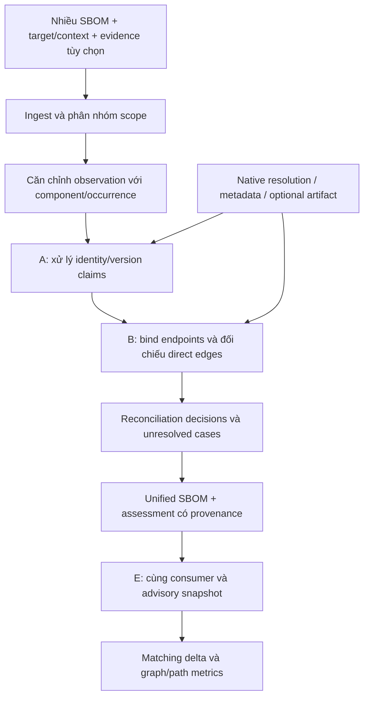

# Kiến trúc V3 — A + B + E

Ngày 12-11-2026. [Đề bài](PROBLEM_FORMULATION.md), [milestones](research/RECONCILIATION_PLAN_V3.md). Đây là thiết kế và draft contracts, chưa có engine multi-SBOM end-to-end. V2 installed Python giữ nguyên.

## 1. Luồng chính

E là evaluation stage. Artifact evidence có thể bổ sung identity/footprint; không bắt buộc giải quyết toàn binary analysis. Một lõi claim/evidence dùng chung liên kết A với B.

## 2. Phạm vi MVP

Identity/name/version/PURL/origin/digest và direct dependencies. Bảo toàn các fields khác dưới dạng observations nhưng chưa xác minh license/supplier toàn diện. Không full function reachability, VEX not-affected hoặc exploitability.

Pilot Java/Maven và npm dùng native dependency/reference tooling; các input được nhóm theo declared/resolved/artifact view và context. Mỗi run có một target/revision/group. Mục tiêu là xem có lợi ích trước native controls, không ấn định corpus lớn theo số lượng repo.

## 3. Modules và interfaces dự kiến

| Module | Input → output | Invariant |
| --- | --- | --- |
| ingest | raw documents → immutable native observations | namespace refs bằng doc digest; không mất source fields |
| scope binder | target/context, producer mode → compatible groups/issues | source/build/artifact hoặc OS khác không trộn ngầm |
| alignment | component observations + candidates/evidence → partial mapping | không gộp hai versions/occurrences chỉ vì cùng name |
| field evaluator | aligned claims + independent evidence → bốn status | producer consensus không tự thành verified |
| edge evaluator | native edges + endpoint mappings + scoped metadata → typed edge claims | endpoint unresolved → defer; containment khác dependency |
| reconciler | claims/policy → applied/report/deferred decisions | không apply UNKNOWN/CONFLICT; không tạo shortcut để graph connected |
| exporter | decisions + raw docs → unified SBOM + assessment | stable refs và provenance; không nâng completeness tùy ý |
| consumer adapter | identity roles + mapping policy → scanner projection | canonical identity giữ lại; mapping có scope |
| evaluator | outputs/frozen DB + scorer-only reference → layer metrics | oracle không vào inference; matching khác exploitability |

## 4. Alignment thiết kế trước field resolution

Observation key là `(document_sha256, native_ref)`. PURL/name/namespace dùng để blocking, không mặc định là same-instance proof. Identity grouping và physical occurrence grouping giữ riêng; cùng PURL có thể nhiều occurrences.

Giữ version-conflict hypothesis và two-real-versions hypothesis khi thiếu locator/hash/resolution evidence. Một PURL/version được xác minh không tự cấp quyền gộp edge của hai installation scopes. Hợp nhất nhầm nodes có thể tạo path không tồn tại trong từng graph.

Alignment decisions gồm `SAME`, `DISTINCT`, `UNRESOLVED`, `CONFLICT`, có reason/evidence. Không dùng graph topology làm nhãn truth ngược cho identity nếu không có cơ sở độc lập.

## 5. Claim/evidence model

Claims có subject/predicate/value/scope. Giữ `SUPPORTED`, `REFUTED`, `CONFLICT`, `UNKNOWN`, tách với alignment status. Source SBOM ghi một giá trị là observation; metadata/native evidence đúng scope mới được admit theo rule.

Mỗi rule khai loại nguồn/capability, binding/context preconditions, conclusion và limitations. Field version có thể cần target metadata/native resolution; digest phải gắn đúng object bytes; relationship cần declaration/resolution semantics, không chỉ co-occurrence.

Evidence của target khác không dùng để sửa target này. Registry mô tả upstream, không tự chứng minh presence. Lockfile/resolved graph chỉ cho context/view tương ứng. Input context được thiếu; rules phụ thuộc selector chưa biết phải giữ unknown.

Optional artifact adapter có binding `DIRECT_ARTIFACT`, `MATCHED_OUTPUT`, `SUPPLIER_ASSERTED`, `UNBOUND`, `MISMATCH` và coverage theo domain. Các binding này do collector tính, không phải quyền một input tự cấp. [Chi tiết adapter](research/design/artifact-reconciliation-v3/architecture.md).

## 6. Graph reconstruction

1. Parse relationship type/orientation và producer mode.
2. Resolve endpoints bằng partial alignment mapping.
3. Nhóm edges theo view/context; giữ raw assertions cùng provenance.
4. Admit metadata/native rules để add/refute scoped edges.
5. Defer ambiguous endpoints/semantics; không dùng no-edge làm negative evidence.
6. Export đúng loại quan hệ và report những gì chưa biểu diễn được.

App→A→B và App→B không mặc định loại trừ nhau. Flattened inventory graph không tự thành dependency graph. Build-input, containment và dependency không thay thế nhau. Mỗi graph view có root/reference scope riêng; không suy no-path thành safe.

sbom-unifier đã merge relationships qua PURL. Baseline phải giữ chức năng này; đóng góp ứng viên là xác minh/correct scopes và edges, không phải thêm relationship union. [Mã baseline](https://github.com/MoriwakiYusuke/sbom-unifier/blob/521f3b8ee6e301e847f7cb113517ba46831e2b28/src/sbom_unifier/merge/merger.py).

## 7. Output

`unified.cdx.json` hoặc SPDX theo profile triển khai; `assessment.json` chứa alignment, field/edge provenance, candidate values, statuses, decisions và gaps. Scanner comparison thêm native-format projections cùng mapping policy.

Không xuất một version tùy ý khi còn hai candidates. Không gộp mọi raw checksums vào một component mà mất object/scope. Không điền `dependsOn: []` cho unknown outgoing dependencies. Unresolved records được giữ rõ thay vì loại khỏi mẫu đo. Format/ref validation không chứng minh nội dung đúng. [CycloneDX](https://cyclonedx.org/docs/1.6/json/), [SPDX relationships](https://spdx.github.io/spdx-spec/v2.3.1/relationships-between-SPDX-elements/).

Không có certificate/checker hoặc conformal. Hợp đồng API chỉ kiểm tra dữ liệu; inference policy và evidence collectors phải được đánh giá riêng.

## 8. E và ablations

Same consumer/config/advisory snapshot cho từng scanner, priority union và proposed output. Ghi match thêm/mất, chuẩn hóa aliases, đối chiếu labels. Không gọi record mới là vulnerability thật tự động.

Các ablation: A-only, union graph trên alignment đã chốt, A+B đầy đủ, bỏ từng loại evidence, và chỉ đổi consumer identity mapping. Có control giữ nguyên components/xóa edges. Edge/path utility đo riêng khi consumer không sử dụng graph để matching.

No-match/no-path không là not-affected. Artifact partial footprint có thể hữu ích cho triage nhưng không tự suppress package warning. Runtime applicability trong MVP để `NOT_ASSESSED`.

## 9. Code hiện có và code mới

- `core/formats.py`: xem xét tái dùng native parse/copy/reference validation; không flatten occurrence IDs.
- `reconciliation/contracts_v2.py`/Python semantics: giữ engine V2 riêng.
- `reconciliation/contracts_v3.py`: draft artifact-evidence contracts, chỉ cho adapter tùy chọn; 32 boundary tests, không phải multi-SBOM solver.
- `reconciliation/merge_contracts_v3.py`: input contract cho A+B+E; scope separation và immutable document references.
- `metrics/*`/run bundles: tái dùng hạ tầng, thay metric definitions theo lớp.
- `gold/*`: chỉ scorer; không dùng installed truth làm artifact/field truth khác view.
- LLM branch: giữ độc lập; chưa có evidence cần model để đạt mục tiêu MVP.

CLI hiện tại không tự chuyển sang V3. Bộ schemas/examples là wire design, không đọc files hoặc verify trust/actual bytes.

## 10. Gate triển khai

Đầu tiên đo disagreement/conflict taxonomy trên subjects paper có fixed revision và reference feasibility. Tiếp theo làm alignment/A, rồi B, rồi E; mỗi mốc có strong baseline nhận cùng evidence. Các cases đã xem dùng development, không làm held-out.

Từ chối automatic apply khi grouping/alignment/evidence chưa rõ. Chấm completeness cùng correctness/unknown coverage; không ép luôn tăng cả hai. Nếu native regeneration/semantic control giải quyết đầy đủ, phải báo tie hoặc giới hạn scope thay vì khẳng định novelty.
