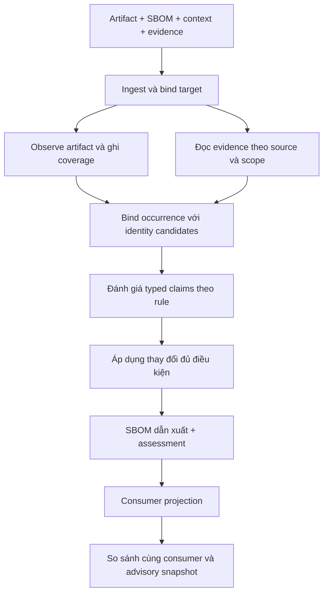

> Draft artifact-only trước khi chọn A+B+E. Tài liệu này chỉ làm phụ lục cho adapter evidence theo artifact; đề bài chính hiện tại ở [PROBLEM_FORMULATION.md](../../../PROBLEM_FORMULATION.md).

# Kiến trúc V3: Reconciliation của SBOM theo artifact và bằng chứng

Ngày 12-11-2026: **thiết kế và hợp đồng dữ liệu ban đầu**. Python V2 vẫn chạy như trước. [Đề bài](../../../PROBLEM_FORMULATION.md), [kiến trúc cũ](../../archive/ARCHITECTURE_PYTHON_V2.md), [milestones](../../ARTIFACT_RECONCILIATION_PLAN.md).

## 1. MVP

Một JAR + CycloneDX JSON 1.6 + evidence tùy chọn. Bản đầu tập trung identity, metadata/class footprint và quan hệ có evidence. Kết luận gắn với hash JAR; runtime/classpath ngoài artifact để `NOT_ASSESSED`.

Ba hành vi đầu tiên:

- Metadata còn nhưng bytecode bị loại: báo metadata-only trong miền đủ coverage, giữ selected/build facts.
- Artifact chứa component SBOM bỏ sót: thêm component khi bind đủ; không tự thêm dependency edges.
- Evidence xung đột hoặc nhiều version phù hợp: báo conflict/ambiguity, không tự chọn version.

Các native adapters cung cấp facts cho lõi dùng chung. Không xây lại mọi scanner/resolver.

## 2. Luồng dữ liệu



Các bước thuộc một pipeline; không có checker/certificate thứ hai. Schema/reference validation kiểm tra dữ liệu, không chứng minh semantic truth.

## 3. Thành phần

| Thành phần | Đầu vào → đầu ra | Giới hạn |
| --- | --- | --- |
| Ingest | bytes/config → immutable refs, target/context | không suy version từ filename, thư mục cha hay Git workspace |
| Evidence binder | source/output hashes → binding assessment | supplier assertion không tự là matched build; hash chỉ ràng buộc bytes |
| Java observer | JAR → archive/class/metadata observations + coverage | không chạy JAR; archive lỗi/giới hạn thành coverage gap |
| Identity binder | occurrence/metadata/upstream evidence → candidates | shared class hashes không đủ chọn exact version |
| Context adapter | native tree/manifest + selectors → selected facts/typed edges | chỉ đúng build/context; null features không là [] |
| Claim evaluator | typed observations/policy → bốn trạng thái | không cộng phiếu; no-detection không là refutation |
| Reconciler | claims/observation → delta/deferrals | preconditions rõ; không nối mọi package với root |
| Exporter | observation/delta/policy → derived SBOM/assessment | giữ relationship semantics, refs, uncertainty |
| Consumer adapter | SBOM/scoped mapping → scanner input | mapping riêng consumer; giữ canonical identity trong assessment |
| Evaluator | snapshots/labels → metrics | oracle chỉ ở scorer; matching/applicability riêng |

## 4. Evidence và coverage

Evidence giữ source kind/hash/locator, collector, target subject/context và limitations. Binding results nội bộ:

- `DIRECT_ARTIFACT`: đọc trực tiếp từ bytes target đã hash.
- `MATCHED_OUTPUT`: record output digest được đối chiếu target, theo trust assumptions của policy.
- `SUPPLIER_ASSERTED`: nhà cung cấp khai record thuộc target, chưa có binding phù hợp.
- `UNBOUND`, `MISMATCH`: chưa nối được hoặc thuộc bytes khác.

Các mức này do collector/binder tính, không phải quyền một file input tự cấp. Input contract chỉ nhận claimed subject; output contract ghi binding result. P0 models không đọc files hoặc kiểm định trust.

Coverage theo target, unit domain và context. Có thể `archive entries=COMPLETE`, `package identities=PARTIAL`, `runtime loading=UNSUPPORTED` cùng lúc. Không có cờ completeness dùng chung cho mọi lớp.

Java observer giữ archive chain, member path/hash, duplicate members và multi-release variants. Archive lỗi/entry không hợp lệ/đạt limits được ghi rõ. Thiếu runtime thì không tự chọn effective multi-release class. Literal path absence không phủ định một class đã relocation; thiếu mapping/unknown transforms khiến miền semantic đó chưa đầy đủ.

## 5. Claims và quyết định

Claim key: `(subject, predicate, object, target hash, phase, context, unit domain)`. Khác phase không ghi đè nhau. Identity resolution và claim status là hai chiều.

| Quan sát | Quyết định |
| --- | --- |
| Bound metadata xác định identity, occurrence duy nhất theo policy | hỗ trợ identity; xét component repair |
| Một vài class hashes dùng chung giữa releases | giữ candidates; không điền exact version |
| Maven chọn B nhưng artifact không còn bytecode B | giữ selected fact; footprint báo riêng |
| B nằm trong JAR | containment fact; dependency cần evidence khác |
| Native A→B cùng build/context, endpoints bind đủ | hỗ trợ direct edge của selected view |
| Rule chứng minh edge bất hoạt với đủ context | rút khỏi selected view, giữ declared fact |
| Evidence thuộc hash khác | không cấp quyền target change |
| UNKNOWN/CONFLICT/AMBIGUOUS | report/defer |

Mỗi rule phải có ID, preconditions, source capabilities và conclusion. Ví dụ:

```text
rule: java.metadata.identity
needs: artifact-bound Maven metadata + unique occurrence binding
concludes: identity occurrence -> coordinate
does_not_conclude: complete payload, direct dependency, reachability
```

Registry lookup chỉ tạo candidates cho đến khi có evidence trong target và đủ điều kiện bind. Không promote package từ registry thành package được ship.

## 6. Orchestration dự kiến

```text
capture immutable SBOM + artifact digests
record partial context and boundary
collect observations with coverage/limitations
bind external evidence to target/context
derive candidates and separate typed claims
evaluate claims using admissible evidence and rules
for each discrepancy:
    if bindings/claims/preconditions satisfy the scoped operation:
        apply to a copy
    else:
        record uncertainty/conflict and missing evidence
validate syntax/references; record exporter limitations
write derived SBOM + assessment
optionally compare projections with fixed consumer/config/advisory snapshot
```

Collector failure không thành empty inventory. Results có thể partial; phải báo phần đã thu và gap. Cú pháp input không đọc được/digest mismatch là invalid request; unsupported payload hay limits là kết quả coverage, không âm thầm loại ca.

## 7. Output và consumer semantics

Profile MVP `PRESERVE_OBSERVATION` giữ dữ liệu chưa đủ cơ sở sửa. Assessment đánh dấu retained observations chưa xác nhận; output không được quảng bá là verified inventory. Profile `ARTIFACT_VIEW` chỉ gồm supported facts xem sau, phải công khai unresolved coverage để tránh lọc mất package.

Identity change giữ bom-ref khi có thể; đổi ref phải cập nhật mọi reference. Component mới không mặc định có `dependsOn: []`; thiếu thông tin dependency để unknown. Không nâng completeness từ coverage của một collector. Upstream complete declarations mâu thuẫn được xử lý rõ trong derived explanation/profile. [CycloneDX 1.6](https://cyclonedx.org/docs/1.6/json/).

Containment dùng biểu diễn đúng format khi làm được; quan hệ không xuất lossless được nằm trong assessment. SPDX adapter sau MVP phân biệt `CONTAINS`, `DEPENDS_ON`, build relations. [SPDX relationships](https://spdx.github.io/spdx-spec/v2.3.1/relationships-between-SPDX-elements/).

Consumer mapping theo role: chỉ instance Go standard library mới có OSV alias `stdlib`; module người dùng tình cờ tên `std` không đổi. Ghi mapping/policy để tách lợi ích adapter với reconstruction.

Artifact/advisory-unit observations là assessment. MVP không sinh VEX `not_affected` hoặc suppress theo no-path/no-match. Package scanner có thể tiếp tục báo cùng advisory khi footprint chỉ còn một phần.

## 8. JS adapter tiếp theo

Bind esbuild metafile tới **đúng output hash** và metadata của input snapshot. `metafile.inputs` là file bundler đọc; dùng `outputs[output].inputs[path].bytesInOutput > 0` làm output-specific contribution evidence. Nối alias với canonical identity qua bound package metadata. [Metafile API](https://esbuild.github.io/api/#metafile).

Zero-byte input không tạo occurrence từ input đó; package có thể góp bytes qua input khác. External import là runtime reference, không có nghĩa được bundle. Thiếu dynamic chunk/outputs làm release boundary chưa đầy đủ. Metafile/sourcemap không tự chứng minh function được giữ hoặc có đường gọi.

## 9. Tích hợp repo

| Hiện có | Quyết định |
| --- | --- |
| core/formats.py: NativeDocument, validation, copy-on-write | đánh giá tái dùng exporter; PURL không là occurrence key |
| contracts_v2.py, marker/extras semantics | giữ V2; không ép artifact context vào installation_scope |
| Evidence storage/hash helpers | tái dùng đúng primitive; raw-byte digest khác hash JSON/path |
| metrics/*, run bundles | tái dùng hạ tầng; V3 metric contract theo lớp |
| gold/* | chỉ scorer đọc labels; installed-reference không thành artifact truth |
| Agent/LLM | giữ độc lập; MVP tất định |

Contracts mới tại `sbom_recovery/reconciliation/contracts_v3.py`: data models và invariants, chưa collect bytes/check trust/infer/export. CLI reconcile hiện tại tiếp tục V2.

## 10. Kiểm chứng thiết kế

Contracts từ chối scope/hash sai, UNKNOWN/CONFLICT có apply, chọn unique từ ambiguity, và presence refutation với coverage sai miền. Facts khác phase cùng tồn tại hợp lệ. Schema checks không tự thực hiện rule inference.

Collector implementation phải test nested/multi-release/metadata-only JAR, duplicate coordinates, unchanged bytes, truncated archives/limits; JS zero contribution/external/output mismatch; unknown dependency record và user-module tên std. Đây là semantic boundary tests, không phải accuracy evidence trên corpus độc lập.

Mỗi milestone có output chạy được và baseline cùng evidence. Discovery cases là development fixtures. Quyết định nghiên cứu dựa trên lợi ích đo trước strong controls/prior art, không dựa vào số module xây được.
